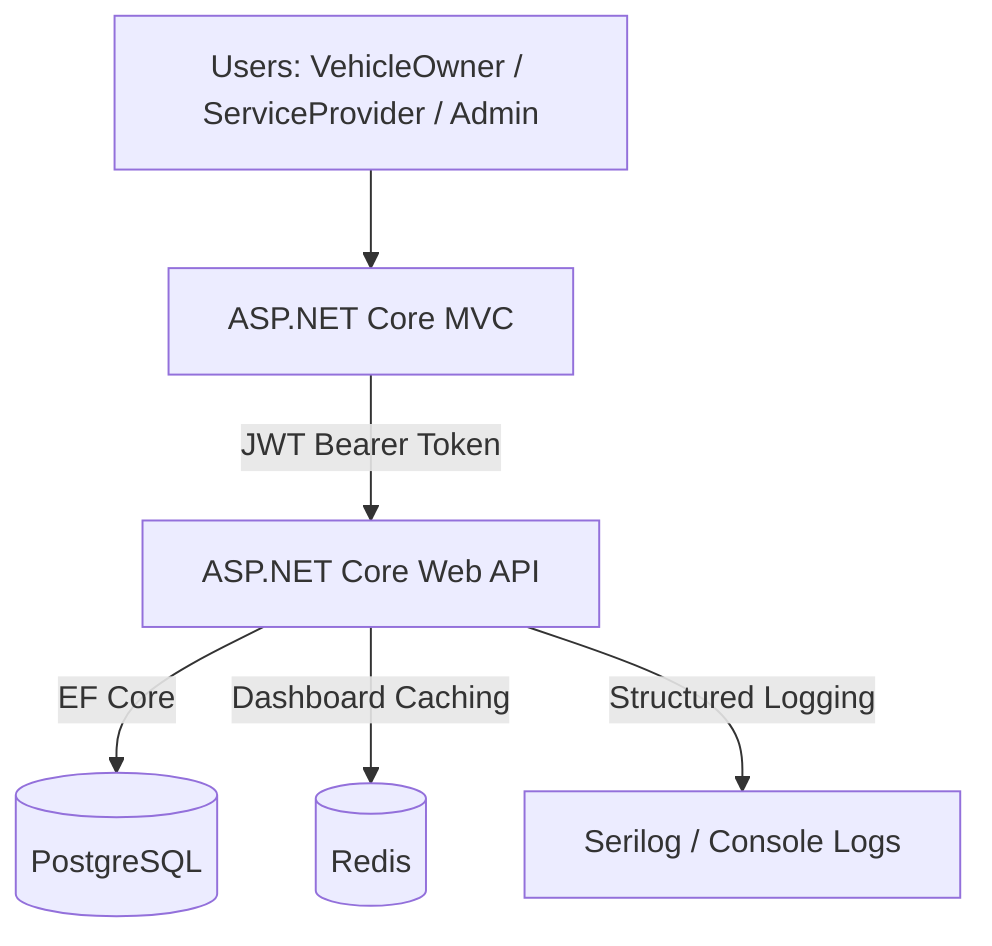
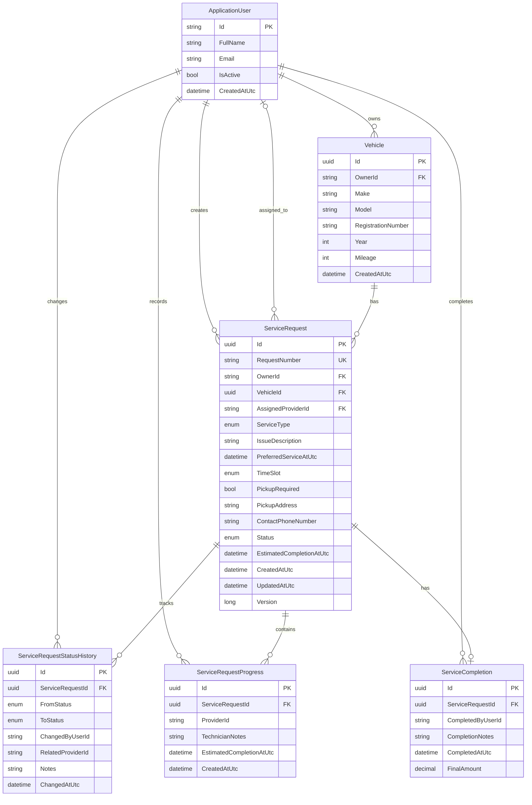
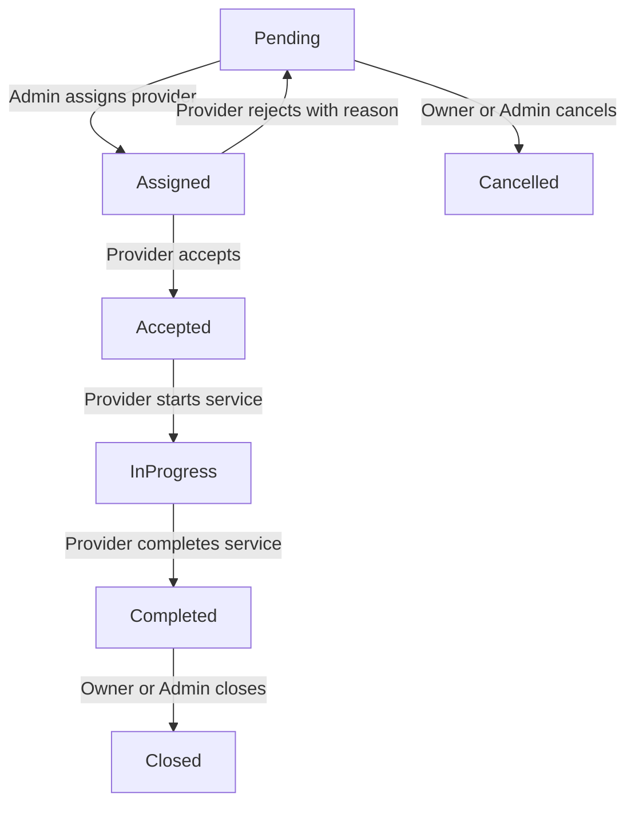

# Vehicle Service Request Management System

A vehicle service request management application built with **ASP.NET Core 8**, **Entity Framework Core**, **PostgreSQL**, and **Redis**.

The application allows vehicle owners to register vehicles and request services, administrators to assign service providers, and service providers to manage the service lifecycle from acceptance through completion.

## Technology Stack

| Component | Technology |
|---|---|
| Backend | ASP.NET Core 8 Web API |
| Frontend | ASP.NET Core MVC, Bootstrap |
| Database | PostgreSQL, Entity Framework Core |
| Authentication | ASP.NET Core Identity, JWT, MVC authentication cookies |
| Authorization | Role-based and ownership-based access control |
| Caching | Redis distributed caching |
| Logging | Serilog |
| Testing | xUnit, Moq, FluentAssertions, SQLite |
| Deployment | Docker, Docker Compose |

## Solution Structure

```text
VehicleService/
├── src/
│   ├── VehicleService.Api/
│   │   ├── Controllers/
│   │   ├── Data/
│   │   ├── Services/
│   │   └── Dockerfile
│   ├── VehicleService.Core/
│   └── VehicleService.Web/
│       ├── Controllers/
│       ├── Models/
│       ├── Views/
│       └── Dockerfile
├── tests/
│   └── VehicleService.Tests/
├── docker-compose.yml
├── .dockerignore
├── .env.example
├── VehicleService.sln
└── README.md
```

The solution separates the shared domain model, API and business logic, MVC presentation, and automated tests into dedicated projects.

## Architecture



The MVC application handles user interaction and cookie-based sessions. It communicates with the API using JWT bearer tokens.

The API is responsible for authentication, authorization, business rules, persistence, and cache invalidation.

## Database Design

The database uses PostgreSQL with Entity Framework Core.

The main business entities are vehicles, service requests, status history, progress updates, and service completions. ASP.NET Core Identity manages user accounts and roles.

### Entity Relationship Diagram



The diagram illustrates domain relationships. User identifiers in audit and progress records may be logical references rather than database-enforced foreign keys, depending on the EF Core mappings.

### Table Responsibilities and Data Lifecycle

| Entity | Purpose | When records are created |
|---|---|---|
| **ApplicationUser** (`AspNetUsers`) | Stores administrators, vehicle owners, and service providers | During owner registration, provider creation, or initial administrator seeding |
| **Vehicle** | Stores vehicle information associated with an owner | When a vehicle owner registers a vehicle |
| **ServiceRequest** | Stores the service request, scheduling details, assigned provider, and current status | When an owner submits a service request; updated as the request progresses |
| **ServiceRequestStatusHistory** | Records status transitions, actors, timestamps, and notes | When a service request changes status |
| **ServiceRequestProgress** | Stores technician notes and estimated completion updates | When a provider records service progress |
| **ServiceCompletion** | Stores final completion notes, completion timestamp, and optional amount | When a provider completes a service request |

### Relationship Cardinality

| Relationship | Cardinality | Description |
|---|---|---|
| VehicleOwner → Vehicle | 1:N | One owner can register multiple vehicles |
| Vehicle → ServiceRequest | 1:N | A vehicle can have multiple service requests |
| VehicleOwner → ServiceRequest | 1:N | An owner can create multiple service requests |
| ServiceProvider → ServiceRequest | 1:N, optional | A provider can be assigned multiple requests; each request has at most one assigned provider |
| ServiceRequest → StatusHistory | 1:N | Each request can have multiple status transitions |
| ServiceRequest → Progress | 1:N | Each request can contain multiple progress updates |
| ServiceRequest → Completion | 1:0..1 | A request can have one completion record after completion |

### Database Design Considerations

- **Auditability:** Status history and progress updates are maintained separately from the current request state.
- **Concurrency:** The `Version` property is used as a concurrency token for service request updates.
- **Referential integrity:** Service requests are associated with vehicles and their owners.
- **Data isolation:** Vehicle owners can access only their own vehicles and service requests.
- **Authentication:** ASP.NET Core Identity maintains additional tables, including `AspNetRoles`, `AspNetUserRoles`, and related authentication tables. These are omitted from the diagram for readability.

## User Roles and Permissions

| Capability | VehicleOwner | ServiceProvider | Admin |
|---|---|---|---|
| Self-register | Yes | No | No |
| Manage own vehicles | Yes | No | No |
| Create service requests | Yes | No | No |
| View permitted requests | Yes | Yes | Yes |
| Create service providers | No | No | Yes |
| Assign service providers | No | No | Yes |
| Accept or reject assignments | No | Yes | No |
| Start and update service progress | No | Yes | No |
| Complete service requests | No | Yes | No |
| Cancel pending requests | Yes | No | Yes |
| Close completed requests | Yes | No | Yes |

Access is enforced by the API using role-based authorization and ownership validation.

## Service Request Lifecycle



The supported transitions are:

| From | To | Authorized role |
|---|---|---|
| Pending | Assigned | Admin |
| Pending | Cancelled | VehicleOwner or Admin |
| Assigned | Accepted | Assigned ServiceProvider |
| Assigned | Pending (Rejected) | Assigned ServiceProvider; rejection reason required |
| Accepted | InProgress | Assigned ServiceProvider |
| InProgress | Completed | Assigned ServiceProvider; completion notes required |
| Completed | Closed | VehicleOwner or Admin |

Invalid status transitions are rejected by the API. Status changes are recorded in the request history.

The provider can also add technician progress notes and update the estimated completion time while the service is in progress.

## Main Features

### Authentication and Authorization

- VehicleOwner self-registration
- Administrator-managed ServiceProvider accounts
- ASP.NET Core Identity for user management and password hashing
- JWT bearer authentication for API requests
- Cookie-based authentication in the MVC application
- Role-based authorization
- Ownership and provider-assignment checks

### Vehicle Management

Vehicle owners can register vehicles with make, model, registration number, year, and mileage.

### Service Request Management

- Create service requests with service type, issue description, and preferred schedule
- Select a preferred time slot
- Optionally request vehicle pickup
- Assign service providers
- Accept or reject assigned requests
- Start services and record progress
- Update estimated completion times
- Complete services with mandatory completion notes
- Record an optional final amount
- Cancel pending requests
- Close completed requests
- View the service request timeline

### Dashboard

Role-specific dashboard summaries provide service request statistics.

### Redis Caching

Redis distributed caching is used for dashboard summaries.

Cache keys are scoped by the relevant user or role to prevent cross-user data leakage.

Cache invalidation is triggered when relevant data changes, reducing the risk of stale dashboard results.

### Structured Logging

Serilog provides application and HTTP request logging.

Docker captures console logs, which can be inspected using Docker Compose.

## Running with Docker

### Prerequisites

- Docker Desktop
- Docker Compose

### Environment Configuration

Create `.env` from the provided example:

```powershell
Copy-Item .env.example .env
```

Update the values in `.env`:

```dotenv
POSTGRES_PASSWORD=your-strong-database-password

JWT_ISSUER=VehicleService.Api
JWT_AUDIENCE=VehicleService.Client
JWT_KEY=your-base64-encoded-random-signing-key
Jwt__ExpiryMinutes=60

SEED_ADMIN_EMAIL=admin@example.com
SEED_ADMIN_PASSWORD=your-strong-admin-password
SEED_ADMIN_FULLNAME=System Administrator
```

The JWT key must be generated securely and must satisfy the API's signing-key requirements.

For Windows PowerShell:

```powershell
$rng = [System.Security.Cryptography.RandomNumberGenerator]::Create()
$bytes = New-Object byte[] 32
$rng.GetBytes($bytes)
[Convert]::ToBase64String($bytes)
$rng.Dispose()
```

Copy the generated value into `JWT_KEY`.

Never commit `.env` or real credentials to source control.

### Start the Application

From the solution root:

```powershell
docker compose up -d --build
```

Docker Compose starts four services:

- PostgreSQL
- Redis
- VehicleService.Api
- VehicleService.Web

### Application URLs

| Application | URL |
|---|---|
| MVC Web Application | http://localhost:8081 |
| Web API | http://localhost:8090 |

Swagger UI is available only when enabled by the API configuration.

### Initial Administrator Account

The initial Admin account is created during application startup using the `SEED_ADMIN_*` environment variables.

Log in through the MVC application using the email and password configured in `.env`.

### Verify Container Status

```powershell
docker compose ps
```

### View Application Logs

```powershell
docker compose logs --tail=100 api
docker compose logs --tail=100 web
```

### Verify Redis

```powershell
docker compose exec redis redis-cli ping
```

Expected output:

```text
PONG
```

### Stop the Application

```powershell
docker compose down
```

The PostgreSQL named volume preserves application data across normal container restarts and recreation.

Avoid `docker compose down -v` unless you intentionally want to delete the stored data.

## Postman API Collection

An importable Postman Collection v2.1 is included to demonstrate and validate the complete Vehicle Service Request API workflow.

The collection contains **30 requests organized into six folders**, covering authentication, vehicle management, service request lifecycle, dashboard queries, alternative workflows, and authorization checks.

### Collection Files

| File | Description |
|---|---|
| `postman/VehicleService.postman_collection.json` | API requests, example payloads, automated assertions, and variable handling |
| `postman/VehicleService.local.postman_environment.json` | Local Docker environment configuration and variables |

### Import and Configure

1. Start the application using `docker compose up -d --build`.
2. Open Postman and select **Import**.
3. Import both JSON files from the `postman/` directory.
4. Select the **Vehicle Service - Local Docker** environment.
5. Configure the following environment variables:

| Variable | Description |
|---|---|
| `baseUrl` | API base URL, default: `http://localhost:8090` |
| `adminEmail` | Email of the seeded administrator |
| `adminPassword` | Password of the seeded administrator |
| `providerPassword` | Password used for the sample service provider |
| `ownerPassword` | Password used for the sample vehicle owner |

The collection automatically manages JWT tokens and captures generated IDs, including `vehicleId`, `providerId`, and `serviceRequestId`.

Passwords and authentication tokens should remain in the local Postman environment and must not be committed to the repository.

### Collection Organization

| Folder | Purpose |
|---|---|
| 01 - Accounts & Authentication | Admin login, provider creation, owner registration, login, and profile verification |
| 02 - Owner / Vehicles | Vehicle creation, listing, and retrieval |
| 03 - Main Service Lifecycle | Create, assign, accept, start, update progress, complete, and close |
| 04 - Read & Dashboard | Service request queries, timeline, and dashboard summaries |
| 05 - Alternative Flows | Provider rejection and request cancellation |
| 06 - Authorization Checks | Authentication, role restrictions, and ownership validation |

### Running the Collection

Open the collection in Postman and select **Run**.

Recommended settings:

- Run type: **Functional**
- Iterations: **1**
- Keep variable values: **Enabled**
- Stop run if an error occurs: **Enabled**

For the complete demonstration, run the collection in its configured request order.

You can also run individual folders. For example, **03 - Main Service Lifecycle** can be executed independently after the authentication and vehicle setup requests have populated the required variables.

The collection includes automated response assertions to validate expected HTTP status codes and key response properties.

### Example Workflow

```text
Admin Login
    |
Create Service Provider
    |
Provider Login
    |
Owner Registration and Login
    |
Create Vehicle
    |
Create Service Request (Pending)
    |
Assign Provider (Assigned)
    |
Provider Accepts (Accepted)
    |
Start Service (InProgress)
    |
Add Progress
    |
Complete Service (Completed)
    |
Owner Closes Request (Closed)
```

Alternative workflows and authorization checks are included to demonstrate rejection, cancellation, and access restrictions.

### Validation

The collection was executed successfully against the Docker-hosted API using Postman's Collection Runner.

The sample requests use environment variables and automatically generated identifiers to reduce manual setup.

## Running Locally

### Prerequisites

- .NET 8 SDK
- PostgreSQL
- Redis
- Visual Studio 2022 or another compatible development environment

### Setup

1. Restore NuGet packages.
2. Configure the API PostgreSQL connection string.
3. Configure JWT issuer, audience, signing key, and token expiry.
4. Configure the initial Admin account.
5. Configure the Redis connection string.
6. Apply EF Core migrations using the application's migration process.
7. Start `VehicleService.Api`.
8. Configure `VehicleService.Web` with the API base URL.
9. Start `VehicleService.Web`.

The MVC application uses the configuration key:

```text
ApiSettings:BaseUrl
```

Local application URLs are defined in the projects' launch settings.

## Automated Tests

The test project uses xUnit, Moq, FluentAssertions, and SQLite.

Tests cover selected service request business rules, status transitions, and dashboard behavior.

Run the test suite:

```powershell
dotnet test --configuration Release
```

To build separately:

```powershell
dotnet restore
dotnet build --configuration Release
dotnet test --configuration Release --no-build
```

## Example End-to-End Workflow

1. An administrator logs in and creates a ServiceProvider account.
2. A VehicleOwner registers and logs in.
3. The owner adds a vehicle.
4. The owner creates a service request, initially in **Pending** status.
5. The administrator assigns a provider, moving the request to **Assigned**.
6. The provider accepts the assignment, moving it to **Accepted**.
7. The provider starts the service, moving it to **InProgress**.
8. The provider adds progress notes and estimated completion updates.
9. The provider completes the service with completion notes, moving it to **Completed**.
10. The VehicleOwner or Admin closes the request, moving it to **Closed**.

The request timeline records the relevant status changes and service activity.

## Security Considerations

- Passwords are hashed and managed by ASP.NET Core Identity.
- API endpoints use JWT authentication and role-based authorization.
- Vehicle and service request access is restricted according to ownership and assignment.
- Sensitive settings are supplied through environment variables or development configuration.
- `.env` and local credentials must not be committed to Git.
- Production deployments should use HTTPS, managed secrets, and appropriate protection for persistent Data Protection keys.

## Design Notes

The application follows a layered structure that separates the domain model, API business logic, MVC presentation, and automated tests.

Business rules and authorization are enforced by the API rather than relying on MVC page visibility.

Service request status history and progress updates are stored separately to provide an auditable service timeline.